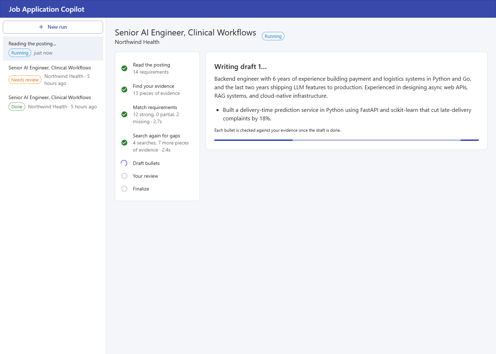

# Job Application Copilot

A LangGraph agent that tailors your resume to a job posting. Paste a posting, and the agent extracts the requirements, matches them against your experience with RAG, and drafts tailored resume bullets. You review the drafts before anything is finalized. Every run is saved in Postgres, so you can close the tab and resume later.

> **Status:** milestones 1 to 6 work: the experience index, the core LangGraph agent (parse a posting, retrieve evidence, match requirements, draft grounded bullets), human review with a Postgres checkpointer, a FastAPI API that streams each step and the draft as it's written over SSE, a React UI to run and review it all, per-run usage with optional Langfuse tracing, and a tool-calling step that searches again for weakly covered requirements.

## How it works

```
job posting
  │
  ▼
parse_posting ──► retrieve_experience ──► match_requirements ──► research_gaps ──► draft_bullets ──► human_review ──► finalize
                                                   ▲                   │                 ▲                 │
                                                   └── new evidence ───┘                 └──── revise ─────┘
```

1. **parse_posting:** an LLM call with structured output (Pydantic) turns the posting into must-have and nice-to-have requirements, seniority, and stack.
2. **retrieve_experience:** for each requirement, hybrid search over your resume, project write-ups, and articles stored in pgvector.
3. **match_requirements:** scores coverage per requirement and lists gaps, with the evidence it found.
4. **research_gaps:** the first search used each requirement's own words, and resumes often say the same thing differently. For requirements that aren't strongly covered, the model gets a `search_experience` tool and up to two turns to search again in its own words ("container orchestration" for "Kubernetes", the industry in a job title). New hits join the evidence pool and match_requirements judges again; if nothing new turns up, the run goes straight to drafting. The model only finds evidence here, it never decides coverage.
5. **draft_bullets:** writes tailored bullets that cite which experience each one came from. It only uses retrieved evidence, so it doesn't invent experience.
6. **human_review:** the graph pauses with a LangGraph `interrupt`. You approve, edit, or ask for a revision. A revision loops back to drafting with your feedback and the previous draft. Edits go through the same grounding checks as the model's bullets and come back for review, so you see any new flags before approving.
7. **finalize:** produces the tailored resume section and a short summary you can paste into an application.

## Features

- [x] LangGraph `StateGraph` with typed state, conditional edges, and retry policies for a busy free tier
- [x] Structured outputs with Pydantic models for requirements, matches, and bullets
- [x] Grounding checks in code: every bullet must cite one role's evidence; invented numbers, mixed roles, and tools that role never used are flagged
- [x] RAG over your experience: resume-aware chunking, Gemini embeddings, pgvector, hybrid search (vector + Postgres full-text, merged with Reciprocal Rank Fusion)
- [x] Human-in-the-loop review with `interrupt` and resume: approve, revise with feedback, or edit
- [x] Postgres checkpointer (`langgraph-checkpoint-postgres`), so runs survive restarts and can be resumed by thread ID
- [x] FastAPI endpoints to start runs, follow them, review drafts, and retry failed steps
- [x] Streaming over SSE: each step as it starts and finishes, and the draft as the model writes it (partial structured output, parsed as the tokens arrive)
- [x] React UI: paste a posting, watch each step finish, then approve, ask for changes, or edit the draft, and copy or download the result
- [x] Tool calling: for weakly covered requirements, the model searches your experience again in its own words, in a bounded loop, and the new evidence is judged again
- [x] Per-run usage (model calls, tokens, time) and Langfuse tracing of every step and prompt
- [ ] Optional: load experience through the [profile MCP server](https://github.com/Eric-Souza/profile-mcp-server) instead of local files

## Stack

| Area | Choice |
|------|--------|
| Agent | LangGraph, LangChain |
| API | Python, FastAPI, SSE |
| LLM | Google Gemini (free tier), with Groq or local Ollama as alternatives |
| Embeddings | Gemini embeddings |
| Database | Postgres + pgvector (Docker locally, Neon free tier hosted) |
| Agent state | LangGraph Postgres checkpointer |
| Frontend | React, TypeScript, Vite, MUI |
| Observability | Langfuse (Hobby free tier) |
| Tests | pytest, Vitest |

## Project structure

```
job-application-copilot/
  apps/
    api/                    # FastAPI + LangGraph
      app/
        graph/
          state.py          # typed graph state
          builder.py        # StateGraph wiring, retry policies, checkpointer
          prompts.py        # system and user prompts per node
          grounding.py      # deterministic checks on drafted and edited bullets
          checkpointer.py   # Postgres checkpointer and the serializer allowlist for state models
          nodes/            # parse_posting, retrieve_experience, match, research_gaps, draft, review, finalize
        routers/            # runs, review decisions, SSE stream, experience ingestion
        services/
          runs.py           # runs the graph in the background, tracks status, publishes events
        tracing.py        # usage counting, and Langfuse tracing when its keys are set
          chunking.py       # resume Markdown -> one chunk per bullet, tagged with its role
          ingest.py         # embed and index files, skip unchanged ones, prune removed ones
          retrieval/        # vector, keyword, and hybrid (RRF) search
          llm.py            # Gemini chat model (with a lite fallback) and embeddings
        main.py             # FastAPI app: lifespan, CORS, routers
        cli.py              # python -m app.cli ingest | search | tailor | resume
        review_text.py      # the CLI's review screen and edit file
        schemas.py          # Pydantic models (requirements, matches, bullets)
      tests/
    web/                    # React + MUI: posting input, live run view, review screen
      src/
        api/                # typed client and the SSE follower
        runs/               # step progress and the useRun hook
        components/         # run list, new run, review panel, result view
  data/resume/              # your resume and project write-ups (gitignored)
  data/samples/             # a fictional sample resume and job posting
  docs/                     # design notes, screenshots
  docker-compose.yml        # Postgres 16 + pgvector
  .env.example
```

## Getting started

```bash
cp .env.example .env        # add GEMINI_API_KEY
docker compose up -d        # Postgres + pgvector on localhost:5435

cd apps/api
python -m venv .venv && source .venv/bin/activate   # Windows: .venv\Scripts\activate
pip install -e ".[dev]"
```

Put your resume in `data/resume/` as Markdown (see [`data/resume/README.md`](data/resume/README.md) for the format, and [`data/samples/sample-resume.md`](data/samples/sample-resume.md) for an example). Then index it and try a search:

```bash
python -m app.cli ingest                     # one batched embedding request per changed file
python -m app.cli search "Kafka microservices" -k 3
```

```
1. [Technical Skills]
   Architecture: System design, microservices, event-driven systems (Kafka, Pub/Sub), multi-tenant SaaS
   rrf=0.033 vector=0.669 keyword=0.400
2. [Experience] Full Stack Engineer · Zro Bank | Jul 2020 – Jun 2022 > Multi-currency digital bank (fintech)
   Scaled the core banking app's backend by splitting it into NestJS microservices that communicate over Apache Kafka, ...
```

Each chunk is one resume bullet, and its role heading is embedded and indexed with it, so a requirement like "healthcare experience" finds bullets whose only mention of healthcare is the job title above them.

Tests run against a separate `copilot_test` database and never call Gemini:

```bash
pytest
```

Tailor your resume to a posting (a sample one is included):

```bash
python -m app.cli tailor ../../data/samples/postings/senior-ai-engineer.md --out tailored.md
```

```
Run e32be77a-d01e-4bcb-b85c-ba4ce704e1c3
   7.9s  parse_posting
   9.7s  retrieve_experience
  37.8s  match_requirements
  52.7s  draft_bullets

Draft 1

Summary:
  Senior Full Stack & AI Engineer with over 8 years of experience ...

Bullets:
  [1] Built a document processing RAG chat system using Python, FastAPI, Gemini, Chroma, and React, ...
      AI Side Projects > Doc Processing AI · E10
  ...

[a]pprove  [r]evise  [e]dit  [q]uit and resume later:
```

The run pauses on the draft:

- **approve** finalizes it.
- **revise** asks what should change and redrafts with your feedback.
- **edit** opens the summary and bullets in `$EDITOR` (Notepad on Windows). Each bullet keeps its `[n]`, which links it to its evidence, and deleting a line drops that bullet. Edited bullets are grounding-checked like the model's, then shown again.
- **quit** saves the run. Every step is checkpointed in Postgres, so you can continue later, even after a restart, and a run that stopped on an API error picks up at the step that failed:

```bash
python -m app.cli resume e32be77a-d01e-4bcb-b85c-ba4ce704e1c3
```

Add `--yes` to approve the first draft without reviewing it.

The output has a summary, bullets grouped by the role they came from, a requirement coverage table (strong, partial, missing, with the evidence ids), and the must-haves with no evidence. Any bullet that fails a grounding check carries a `Check:` line saying what to verify.

### API

Start the server from `apps/api` (`--loop` matters on Windows only: psycopg's async mode needs the selector event loop):

```bash
uvicorn app.main:app --loop app.db:LOOP_FACTORY --port 8000
```

| Endpoint | What it does |
|---|---|
| `POST /runs` | Start a run with `{"posting": "..."}`; returns its id right away (202) |
| `GET /runs` | Recent runs with their status: `running`, `awaiting_review`, `done`, or `failed` |
| `GET /runs/{id}` | A run's status, the draft under review or the final resume, its usage, and its Langfuse link |
| `GET /runs/{id}/events` | SSE stream: `status`, then `step` and `node` as each step starts and finishes, `draft` with the text so far while the draft is written, then `review`, `done`, or `error` |
| `POST /runs/{id}/review` | `{"action": "approve"}`, `{"action": "revise", "feedback": "..."}`, or `{"action": "edit", "summary": "...", "bullets": [...]}` |
| `POST /runs/{id}/retry` | Continue a failed run from the step that failed |
| `POST /experience/ingest` | Index `data/resume/` |
| `GET /experience/search?q=...` | Search your experience (`mode` = vector, keyword, or hybrid) |

Interactive docs are at `http://localhost:8000/docs`. Runs that were in progress when the server stopped are marked failed on startup and can be retried. Runs started from the CLI don't show up in `GET /runs`.

### Web UI

With the API running on port 8000, start the UI from `apps/web` (Node 20.19+):

```bash
npm install
npm run dev                  # http://localhost:5173, proxies /api to localhost:8000
npm test                     # Vitest, no API needed
```

Paste a posting and press Start. Steps tick off as they finish, and the draft appears as the model writes it. Once it's complete and checked, it shows up for review: bullets grouped by role, with their requirement and evidence ids (hover for what they refer to), any grounding flags, and a coverage table with the model's reasoning for each requirement and anything it searched for again. Approve it, ask for changes in plain words, or edit the text yourself. A failed run (a Gemini quota error, say) has a Retry button that continues from the failing step. Runs are listed on the left, and a run's page can be reloaded or bookmarked at any point.



### Tracing

Every run counts its model calls, tokens, and the time it spent running (not the time it waited for you), and shows them in the UI and the CLI. For a full trace of each step, with the prompts, responses, token counts, cost, and latency of every model call, set the Langfuse keys in `.env`:

```bash
LANGFUSE_PUBLIC_KEY=pk-lf-...
LANGFUSE_SECRET_KEY=sk-lf-...
LANGFUSE_HOST=https://cloud.langfuse.com   # or your self-hosted Langfuse
```

Each segment of a run (up to the review, each revision, a retry) is one trace, and a run's traces share a Langfuse session named by the run id, so a run with two revisions reads as one timeline. The run page links to it. With the keys empty, tracing is off and nothing leaves your machine except the Gemini calls.

Self-hosting Langfuse (it's free, and Docker Compose runs it) keeps traces on your machine too. Langfuse prices calls at Gemini's paid rates; on the free tier, add a model definition in the project's settings that matches `gemini-.+` at $0 so cost reads $0.

## Free to run

- **Gemini API (AI Studio):** free tier for chat and embeddings.
- **Postgres + pgvector:** local Docker, or Neon's free tier.
- **Langfuse Hobby:** free tracing.
- **Ollama:** fully local, if you'd rather not send your resume to an API.
